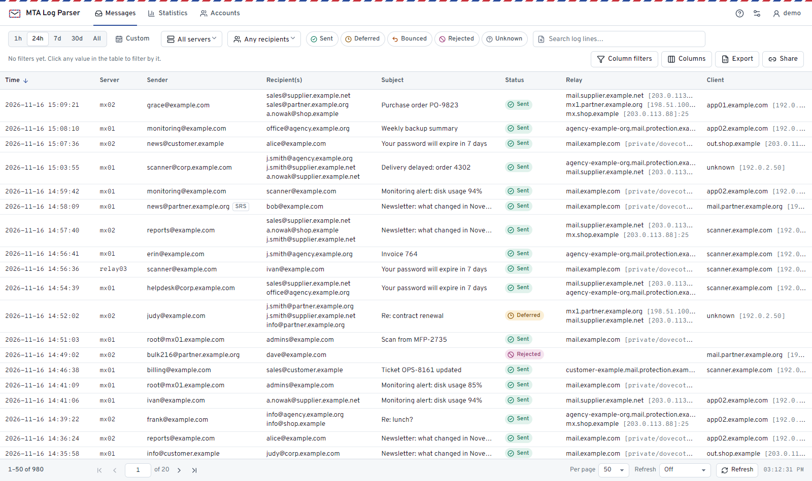
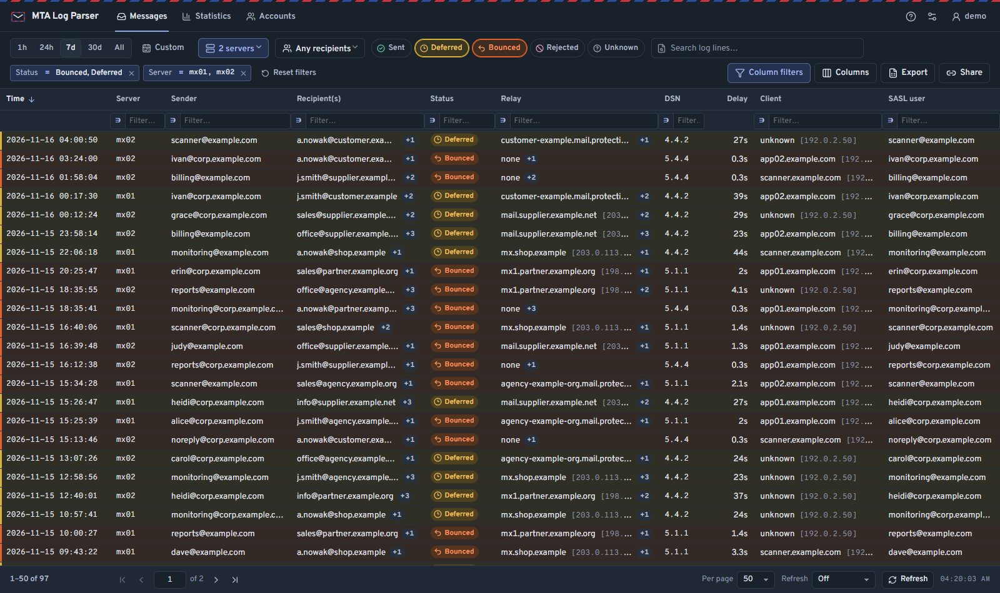
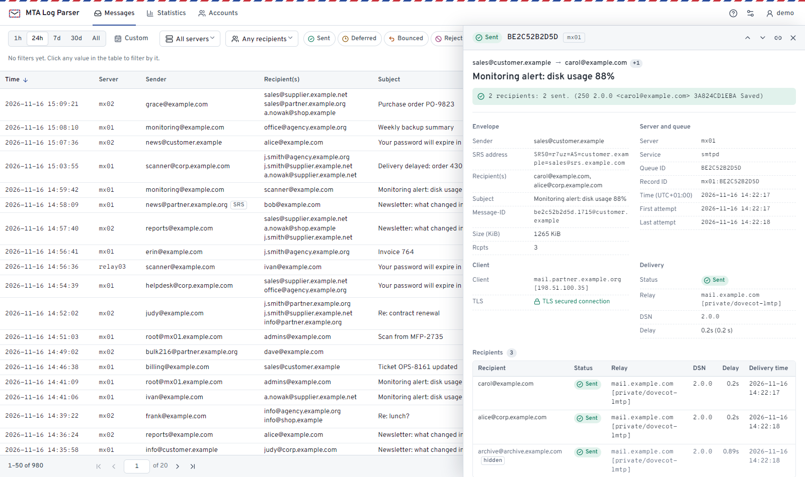
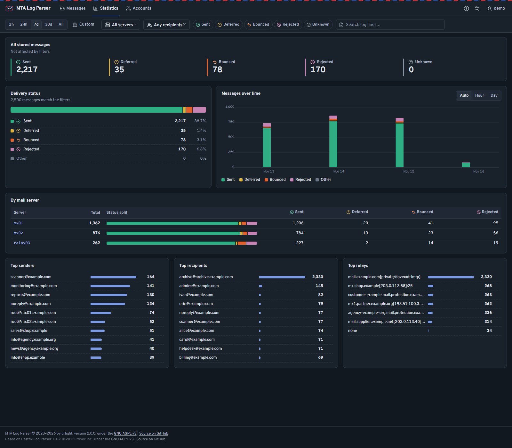
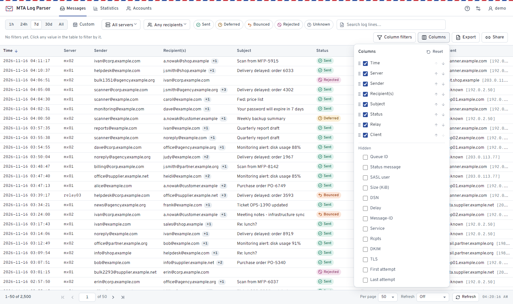

<h1> MTA Log Parser with Web UI</h1>

A small application that parses the logs of SMTP servers (**postfix**; also exim — see
[this page](https://github.com/drlight17/mta-log-parser/wiki/Exim-and-correct-log-parsing) — sendmail and
Microsoft Exchange), stores every message as a queryable document in [RethinkDB](https://rethinkdb.com/) and lets
you trace mail in a web UI: who sent what to whom, through which server, client and relay, and how each
delivery ended.

The backend is [Quart](https://github.com/pgjones/quart) (JSON API); the web UI is a single-page app built with
React. This is a fork of the abandoned [Privex postfix log parser](https://github.com/Privex/postfix-parser).

> **This application is NOT intended to be public facing.** Keep it inside a corporate VPN / LAN and put it behind
> HTTPS. It has its own accounts (stored in RethinkDB, hashed) or LDAP — one of the two is active at a time.



## What's new in 2.0

- **Several mail servers in one UI.** Every message records the server (`host`) that logged it — taken from the
  syslog header, so one central syslog file with many servers works, and so do several files
  (`MAIL_LOG_FILENAME=mail.log,mail.log.1`, globs, `.gz`). Queue IDs from different servers never collide.
- **Much more data per message (postfix):** client (`host [ip]`) and SASL login, the receiving service
  (`smtpd`, `submission`, `smtps`, `pickup`), relay (`host [ip]:port`, also `relay=none` and LMTP), DSN, delay and
  delay breakdown, number of recipients, DKIM signature (from opendkim), TLS, and **every recipient's own
  delivery** (address, original address, status, relay, DSN, delay, time).
- **Honest status for multi-recipient mail.** A message gets the status of its worst delivery (bounced > rejected >
  deferred > sent) instead of the old catch-all `multiple` — on servers that add an archive copy to every message
  the old status hid failed deliveries. `LEGACY_MULTIPLE_STATUS=true` restores the 1.x behaviour.
- **Hidden recipients** (2.1): `HIDDEN_RECIPIENTS=backup@archive.local` (addresses or patterns such as
  `*@archive.local`) keeps an archive / `always_bcc` copy out of the recipient list, status and relay. The copy is
  still shown, marked *hidden*, in the message details, and a failed archive delivery is noted in the status message.
- **Original sender of forwarded mail** (2.1): SRS-rewritten envelope senders (postsrsd,
  `SRS0=HHH=TT=example.com=john@srs.example.net`) are shown as `john@example.com` with an *SRS* tag; filtering by
  sender matches both addresses (`DECODE_SRS=false` turns it off).
- **New web UI:** choose, reorder and resize columns; filter any column (contains / does not contain / is exactly),
  click any value to filter by it; every recipient and relay of a message listed right in the table (or the first
  one and +N, see Settings); status chips, server picker, time presets; message drawer with all metadata,
  the recipients table and the raw log lines; statistics per server, top senders / recipients / relays and a
  timeline; dark and light themes; English, Polish and Russian.
- **Excel export** of the visible columns — current page or all matching rows — with an optional second sheet
  listing every recipient delivery.
- **Security hardening** (see [Security](#security)) and a faster importer (batched writes, no `datefinder` for
  standard syslog timestamps).

The design document with the data model and the full API is in [docs/DESIGN-v2.md](docs/DESIGN-v2.md).

| | |
|---|---|
|  |  |
|  |  |

## Columns and filters

All columns can be shown, hidden and reordered (the choice is stored in the browser). Every column below is also a
filter in the API (`/api/emails?<field>=text`, `<field>__not=text`, `<field>__eq=text`) and goes into the export.

| column | field | example |
|---|---|---|
| Time, first / last attempt | `timestamp`, `first_attempt`, `last_attempt` | `2026-10-26 06:28:47` |
| Server | `host` | `mx01` |
| Queue ID | `queue_id` | `25CF61E7BCF` |
| Sender, recipient(s) | `mail_from`, `mail_to` | `dms@example.com` (SRS senders decoded, the SRS address is in `srs_from`) |
| Subject, Message-ID, size | `subject`, `message_id`, `size` | needs `header_checks` with `WARN` for the subject |
| Status, status message | `status.code`, `status.message` | `sent`, `deferred`, `bounced`, `reject`, `unknown` |
| Relay | `relay` | `example-com.mail.protection.outlook.com [52.101.91.156]:25` |
| Client | `client` | `unknown [192.0.2.50]` |
| SASL user / method | `sasl_username`, `sasl_method` | `dms@example.com`, `login` |
| Service | `service` | `submission` |
| DSN, delay | `dsn`, `delay` | `2.6.0`, `1.9` |
| Recipients count | `nrcpt` | `2` |
| DKIM | `dkim.domain` | `example.com` (`s=default`) |
| TLS | `tls` | secured / not secured |
| More than one recipient | `multiple` | `multiple__eq=true` |
| Raw log lines | `log_lines` | full-text, needs a time range |

## Dockerized usage (recommended)

**Requirements:** Docker with the compose plugin.

```bash
git clone https://github.com/drlight17/mta-log-parser
cd mta-log-parser
cp example.env .env
nano .env          # at least MAIL_LOG_PATH, MAIL_LOG_FILENAME and a long random SECRET_KEY

# build the image yourself (needed for 2.0 until a 2.0 image is published on Docker Hub)
cp -f build/Dockerfile ./Dockerfile
cp -f build/docker-compose.yaml ./docker-compose.yaml
docker compose up -d --build

# import the logs every minute (host crontab)
crontab -e
*/1 * * * * docker exec -t mta-log-parser flock /tmp/lck_mlp /app/run.sh cron
```

Open `http://<host>:<PORT><PATH_PREFIX>/`. The first visit asks you to create the first account; more accounts are
managed under **Accounts**.

Docker notes:

- The app container runs as an unprivileged user (uid 1000) and mounts the mail log **read-only**; give it the group
  that may read the log with `MAIL_LOG_GID` (default `4` = `adm` on Debian/Ubuntu).
- The RethinkDB admin UI listens on the host's loopback interface only (`127.0.0.1:${RETHINK_EXP_GUI_PORT}`); use an
  SSH tunnel to reach it. Set `RETHINK_USER` / `RETHINK_PASSWORD` if your RethinkDB has accounts.
- RethinkDB data stays in `./rethinkdb_data`, as in 1.x.
- If `SECRET_KEY` is empty or a known default, a random key is generated once and kept in the `mlp_instance` volume
  (with a warning in the log). Behind HTTPS set `SESSION_COOKIE_SECURE=true`.

### Several mail servers

- **Central syslog** (one file with lines from many servers): nothing to do — the server name is read from every line.
- **One file per server**, e.g. collected into `/var/log/mail/<server>/mail.log`:
  `MAIL_LOG_PATH=/var/log/mail` and `MAIL_LOG_FILENAME=*/mail.log`.
- **Logs without a syslog header** (e.g. exim `mainlog`): set `MAIL_HOST_NAME` to the server's name.
- **An archive copy on every message** (`always_bcc`, LMTP to an archive mailbox): list the address in
  `HIDDEN_RECIPIENTS`. The setting is applied when messages are imported, so messages already stored change only if
  their lines are imported again.
- Include the previous rotated file so messages that span a rotation stay complete:
  `MAIL_LOG_FILENAME=mail.log,mail.log.1`.

## Upgrading from 1.x

1. Rebuild/pull the image and restart (`upgrade.sh` does that for the Docker Hub image).
2. **Message IDs changed** from `<queue_id>` to `<server>:<queue_id>`. Messages already stored keep their old ID, so
   messages that are still in the current log appear twice until `HOUSEKEEPING_DAYS` removes the old copies. To drop
   the 1.x documents right away, run in the RethinkDB admin UI (Data Explorer):
   `r.db('maildata').table('sent_mail').filter(r.row.hasFields('host').not()).delete()`
3. Accounts keep working: plaintext passwords stored by 1.x are converted to hashes at the next login. Passwords must
   now have at least 8 characters for new accounts.
4. The old web UI (`/emails`, `/auth`, form logins) is gone; bookmarks to `/emails?...` open the new UI.
5. New settings — all optional — are documented in [example.env](example.env): `MAIL_HOST_NAME`,
   `LEGACY_MULTIPLE_STATUS`, `HIDDEN_RECIPIENTS`, `DECODE_SRS`, `IMPORT_BATCH_SIZE`, `LOCK_FILE`, `SESSION_COOKIE_SECURE`, `SESSION_LIFETIME_HOURS`,
   `LOGIN_MAX_FAILURES*`, `RETHINK_USER`/`RETHINK_PASSWORD`, `QUERY_TIMEOUT`, `LDAP_TIMEOUT`, `MAIL_LOG_GID`.

## Security

2.0 fixes a number of problems found in a review of 1.8.5; upgrading is strongly recommended.

- Account management required no login (anyone could create or delete accounts) — now only signed-in users, plus a
  one-time setup when there are no accounts.
- Passwords were stored and logged in plaintext and returned by an API — now hashed (werkzeug), never logged or
  returned.
- LDAP: the user name is escaped in the search filter, empty passwords (anonymous bind) are rejected, LDAP calls run
  off the event loop with timeouts.
- The default `SECRET_KEY` allowed forging sessions — it is never used now.
- Sessions expire (`SESSION_LIFETIME_HOURS`) and end when the password changes or the account is deleted; cookies are
  `HttpOnly`, `SameSite=Lax`, optionally `Secure`; state-changing requests need a JSON body and a custom header (CSRF).
- Login throttling; strict Content-Security-Policy and other security headers; the UI never renders log data as HTML.
- Filter text is matched literally (no user regular expressions), sort fields and filters are validated, queries
  have a timeout.
- Docker: non-root container, read-only log mount, RethinkDB admin UI on localhost only, allow-list `.dockerignore`.

## LDAP authentication

The web UI uses LDAP instead of local accounts when `LDAP_CONNECT` is set; see [example.env](example.env).
Prefer `ldaps://`.

## Install without Docker (not supported by the upstream author)

Requirements: RethinkDB, Python 3.11+ (3.12 recommended), pipenv. The built web UI is committed in
`mlp/static/app`, so Node.js is only needed to change the UI (see [web/README.md](web/README.md)).

```bash
apt install -y python3 python3-dev python3-pip libsasl2-dev libldap2-dev libssl-dev
python3 -m pip install -U pipenv
adduser --gecos "" --disabled-password mailparser
gpasswd -a mailparser adm        # read access to the mail log
su - mailparser
git clone https://github.com/drlight17/mta-log-parser && cd mta-log-parser
pipenv install
cp example.env .env && nano .env
crontab -e     # * * * * * flock /tmp/lck_mailparser /home/mailparser/mta-log-parser/run.sh cron
```

`./run.sh dev` starts the development server, `./run.sh parse` imports the logs once, `./run.sh prod` runs Hypercorn
(see `mta-log-parser.service` for systemd).

## Nginx reverse proxy

To serve the UI under a path such as `https://example.org/logs`, set `PATH_PREFIX=/logs` in `.env`:

```nginx
location /logs/ {
    proxy_pass http://127.0.0.1:8487;
    proxy_set_header Host $host;
    proxy_set_header X-Forwarded-Proto $scheme;
}
```

## Development

- Tests: `pipenv install --dev`, a RethinkDB on `localhost:28015`, then `python -m pytest` (parser tests use
  anonymised fixtures in `tests/fixtures/`, API tests use their own database).
- Demo data: `python tools/gen_demo_log.py --messages 2000 > demo.log` writes a synthetic multi-server postfix log
  (example domains and documentation IP ranges only) — the screenshots above were made from it.
- Web UI: see [web/README.md](web/README.md) (`npm run dev:mock` runs it without a backend).

More information: [project wiki](https://github.com/drlight17/mta-log-parser/wiki).

# License

This project is licensed under the **GNU AGPL v3**. For full details, see `LICENSE.txt` and `AGPL-3.0.txt`.

# 💰 Support
This application is absolutely free. But any attention motivates me to support the application. You can send a donation of $1 or more to a TON wallet:
```
UQBz_YJrj5-PCpYIqr7wsdspdSgrzETS02N2t0KSo1njX0FJ
```
and/or [](https://github.com/drlight17/mta-log-parser) this repository.
